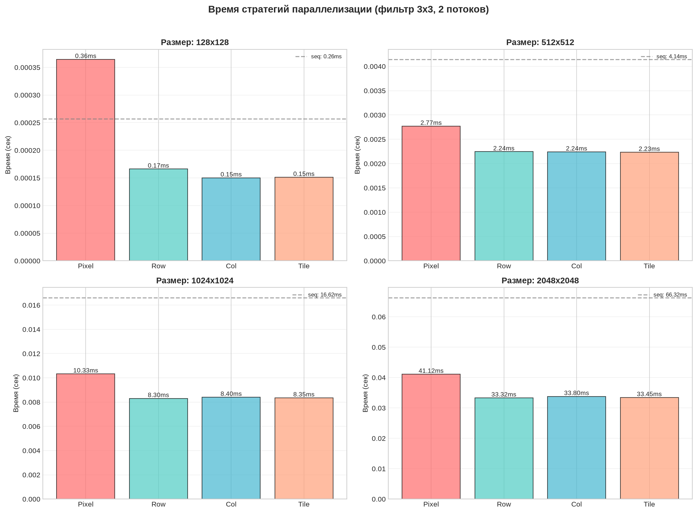
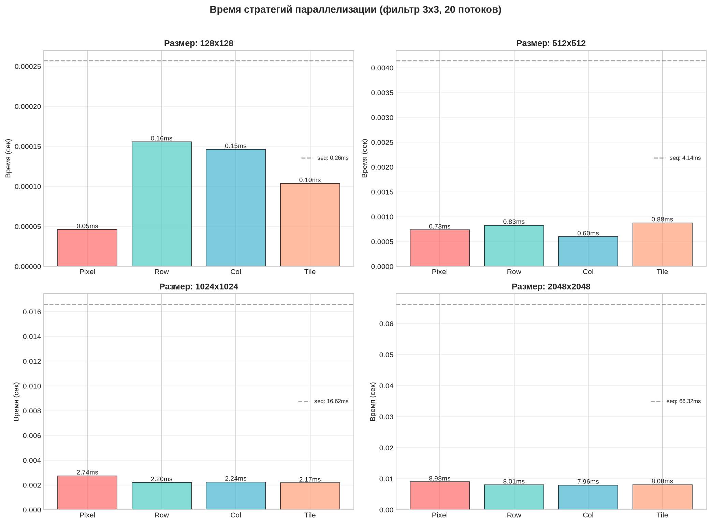
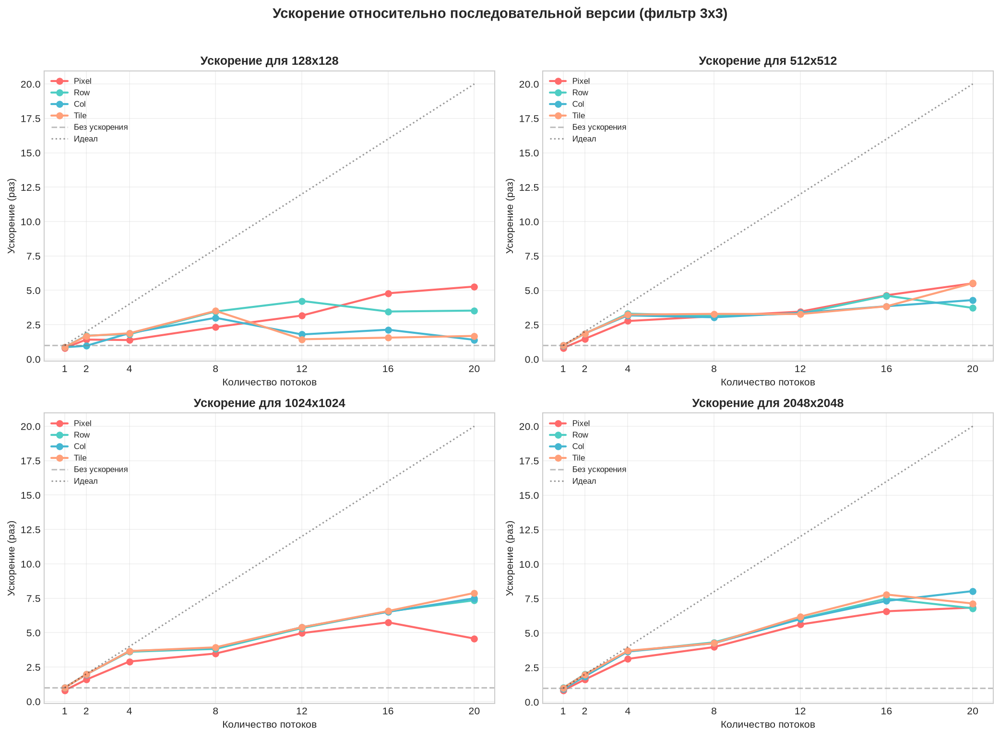
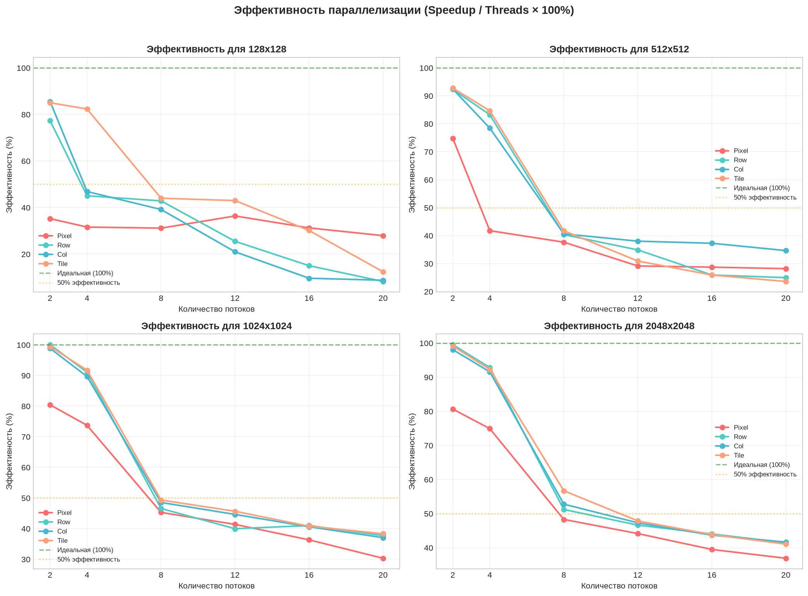

# Задача 2

Реализация параллельной свёртки изображений с различными стратегиями распараллеливания на C с использованием OpenMP.

##  Использование
```bash
make all # сборка проекта
make test # запуск тестов для различных фильтров и стратегий параллелизации
make run # сборка и запуск с настройками по умолчанию
make clean # очистка
make help # справка
# запуск исполняемого файла
./build/convolution_seq
```


### Стратегии параллелизации

| Стратегия | Описание |
|-----------|----------|
| **Sequential** | Последовательная обработка (эталон) |
| **Pixel** | Распределение отдельных пикселей между потоками |
| **Row** | Распределение строк изображения между потоками |
| **Column** | Распределение столбцов между потоками |
| **Tile** | Разбиение на прямоугольные плитки (32×32) |

## тестовое окружение
|  |  |
|---------|---------|
| **CPU** | 12th Gen Intel(R) Core(TM) i7-12700H |
| **RAM** | 16 ГБ |
| **ОС** | Arch Linux x86_64 |
| **число потоков** | 20 |


### Зависимости
- GCC с поддержкой OpenMP
- Библиотека stb_image для загрузки/сохранения изображений
- pandas и matplotlib для работы с бенчмаркингами

## График 1

Стратегии Row, Col, Tile стабильно дают результат в 2 раза быстрее относительно последовательной обработки, что является абсолютно
корректным поведением при 2 потоках. Pixel даёт в среднем на 20% большее время, за исключением изображения размером 128x128, где время
исполнения даже больше, чем у Seq. Это объясняется накладными расходами.

## График 2

Для изображений размером 1024х1024 2048х2048 поведение схожее с предыдущим графиком. В изображениях 512х512 и 128х128 графики ведут 
себя странно, что может быть обусловенно с шумами(например с железом: у меня на в процессоре 6 ядер с hyperthreading и 8 без).

## График 3

На нижних графиках рост стабильный до ~7-8x в зависимости от стратегии. В переходе между 4 и 8 потоками наблюдается плато.
Возможная причина - новые потоки попадают на уже работающие ядра с hyprthreading, а не на новые. На 128x128 возникают шумы, связанные
с слишком маленькими размерами изображения.

## График 4

Эффективность у всех стратегий падает с увеличением количества потоков.
Резкий спад на 4-8 потоков объясняется всё теми же причинами. График в целом несёт ту же информацию, что и прошлый, сделан для большей наглядности.

# Общие выводы
Row, Col и Tile работают практически одинаково: около 2× на 2 потоках и 8–8,7× на 20 при крупных изображениях и больших фильтрах.
Размер задачи важнее выбора стратегии: на 128×128 результаты шумные, и параллелизм на 20 потоках там не оправдан.
